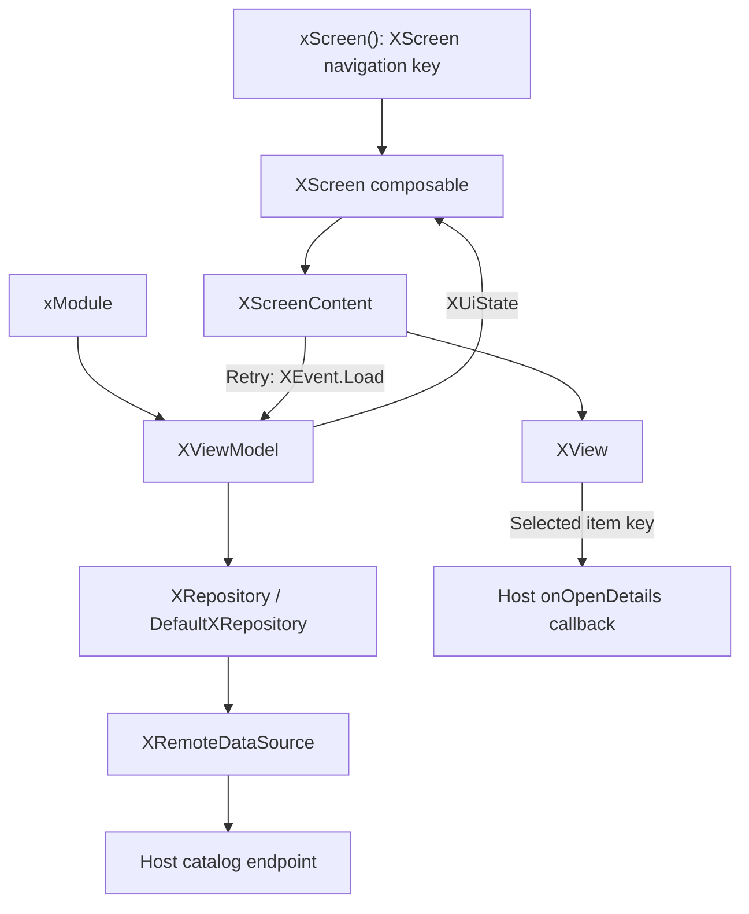

# `:feature:x` Logic Graph

## Purpose

Displays a remote inventory catalog. Users can select an entry and hand its identifier to the
host's detail action.

## Owns

- The catalog page, loading state and retry event.
- HTTP reads and conversion from the catalog JSON to application and UI models.

## Does not own

- The HTTP client configuration, catalog endpoint or details destination. The host supplies these.

## Host requirements

- Load `xModule` with a JSON-enabled Ktor `HttpClient`, `TelemetryRepository` and the endpoint
  String qualified by `xEndpoint`. The endpoint returns an array with `id`, `title` and
  `availableQuantity` fields.
- Supply localized `x_title` and `x_load_failed` resources.
- Register `xScreen(onOpenDetails = ...)` in the shell graph and include its `XScreen` key in the
  host's existing serialization setup. The callback receives the selected catalog item's key.

## Depends on

- Compose, Koin, Ktor and Kotlin serialization.
- Toolkit screen, navigation, telemetry and network APIs.

## Used by

- The host's shell graph and Koin composition root.

## Flow chart

## Architectural decisions

- `XViewModel` requests the first load and handles retry through `XEvent.Load`. Duplicate requests
  keep the active load. The screen renders loading, ready, empty and failure states.
- The default binding uses the remote source. An optional `XLocalDataSource` can be wired for
  offline fallback. It is used only when the remote read reports no internet.
- The base catalog reads `XRepository` directly. Quantity filtering through `XUseCase` and indexing
  through `xSettingsSearchProvider` are optional integrations.

## Public contracts

- `xModule`, `xScreen()`, the `XScreen` navigation key and the `XScreen` composable.
- `XViewModel`, `XUiState`, `XEvent`, `XItem`, `XRepository` and `XModel`.

## Internal implementations

- `XRemoteDataSource` decodes `XDto`. The repository maps it to `XModel` and the UI maps it to
  `XItem`. `XScreenContent` renders the rows and delegates detail selection to the host.

## Current risks

The default binding has no offline snapshot. An unavailable endpoint produces a load failure and
the screen offers Retry when the failure is retryable.
