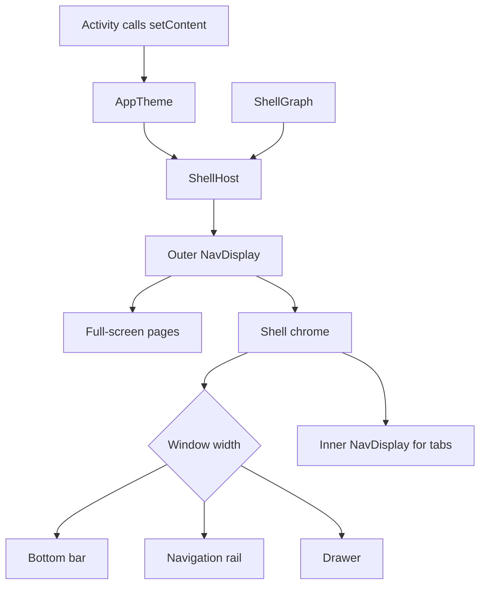

# Shell and Navigation

The host app declares destinations in a `ShellGraph`. The shell reads that graph and
chooses the navigation layout based on the window width.



## Host the graph

Use `toolkitGraph { ... }` when the host needs Toolkit pages such as Settings. Pass
the resulting graph to the shell from your activity.

```kotlin
setContent {
    AppTheme {
        ShellHost(graph = graph)
    }
}
```

`ShellHost` can resolve a startup destination, report destination changes, and handle
deep links declared by the graph. The [shell module README](https://github.com/MihaiCristianCondrea/App-Toolkit-for-Android/blob/develop/library/shell/README.md)
and [navigation module README](https://github.com/MihaiCristianCondrea/App-Toolkit-for-Android/blob/develop/library/navigation/README.md)
describe these contracts in more detail.

[Open the ShellHost API](../library/shell/com.mihaicristiancondrea.android.libs.apptoolkit.shell/-shell-host.html)
