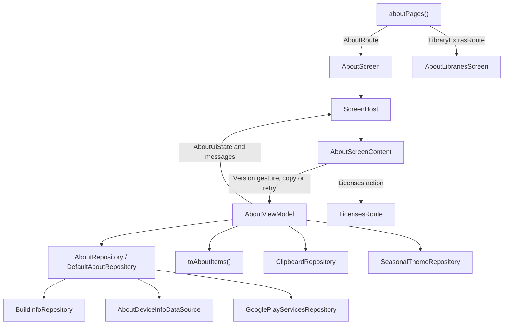

# `:library:feature:about` Logic Graph

## Purpose

Owns the App Toolkit About screen: host application, App Toolkit, and Google Play services metadata,
plus the tap-to-copy interaction for the entries it renders and the version-tap easter egg.

## Owns

- About information presentation (host application, App Toolkit, and Google Play services versions,
  and the host-formatted device report).
- Its rows in the settings search, a `settingsSearchProvider` bound as `about`: app info, device
  info and the open-source licenses, which opens the licenses page.
- Tap-to-copy for About entries, including the clipboard write and its in-app confirmation.
- The version-tap easter egg: konfetti on the fifth tap, and the seasonal themes unlock it records.
- The About Libraries destination keeps its content in `AboutLibrariesScreen.kt` and reports
  visits through `ScreenHost` using its own analytics identifier.
- `aboutPages()`, the registration of `AboutRoute` (a detail of the settings list) and
  `LibraryExtrasRoute`.

## Does not own

- Open-source licenses, owned by [`:library:feature:licenses`](../licenses/README.md); the About
  list only navigates to `LicensesRoute`.
- Privacy and legal entries, owned by [`:library:feature:privacy`](../privacy/README.md).
- Changelog retrieval, presentation, and in-app-update triggering, owned by
  [`:library:feature:changelog`](../changelog/README.md).
- The drawer and its entries, declared by the app in its shell graph; Share and Updates are drawer
  actions there.
- Host main screen and host route keys, owned by `:sample`.
- Host identity strings, supplied as overridable defaults by `:library:core:common`.
- The device report itself, supplied by the host through `AboutDeviceInfoDataSource`.
- The consent, review and update hosts. Each integration module builds its own from the activity
  (`ConsentHost`, `ReviewHost`, `InAppUpdateHost`).

## Host requirements

Bind an `AboutDeviceInfoDataSource` that supplies a formatted report suitable for display and
copying. Its `deviceInfo` property is read on the main thread. A blank report is omitted.

## Depends on

- `:library:core:common` and `:library:core:ui` for shared state, platform helpers, and Compose.
- [`:library:core:datastore`](../../core/datastore/README.md) for `SeasonalThemeRepository`, which
  stores the easter egg unlock.
- [`:library:navigation`](../../navigation/README.md) for the keys and the graph builder.
- `:library:integration:gms` for the main-safe `GooglePlayServicesRepository`.

## Used by

- [`:library:apptoolkit`](../../apptoolkit/README.md), which calls `aboutPages()` from
  `toolkitPages()`.
- `:sample:app`, which registers `aboutPages { AboutScreen() }` before the Toolkit adds its pages.
- `:sample:feature:about`, which provides the formatted device report.

## Flow chart

## Architectural decisions

- About screen presentation is data-driven: `AboutRepository` returns the raw `AboutInfo` metadata
  and `ui/mappers` turns it into an ordered list of `AboutItem` models (headers and grouped
  preferences) with titles, summaries, actions, and card positions, so `AboutScreen` remains purely
  declarative and the data layer stays free of rendering concerns.
- The clipboard is a platform data source, so `AboutViewModel` writes it through
  `ClipboardRepository` from `:library:core:common` and holds no `Context`. The write runs on the
  main dispatcher, where `viewModelScope` already is, because it is a system UI interaction.
- A successful copy is confirmed in-app only where the system does not confirm it itself
  (`ClipboardRepository.confirmsCopies`, true from Android 13, which raises its own clipboard
  preview). A failed copy raises no system UI on any version, so it is always reported. A fake
  repository sets both cases in tests, without a device.
- `AboutItemAction.CopyToClipboard` carries the label, the exact text, and an optional confirmation
  message, so any row becomes copyable without a new event, and the clipboard receives what the row
  displays rather than a second lookup resolved under a different configuration. Both texts are
  `UiText`, so a row whose value is a string resource copies as readily as one holding a
  formatted value.
- The build-version row counts taps toward the easter egg. Clipboard actions on other rows copy the
  displayed value. The licenses row opens `LicensesRoute`.
- The fifth tap plays konfetti when system animations are enabled and raises
  `AboutEvent.EasterEggFound`. `AboutViewModel` records the unlock through
  `SeasonalThemeRepository`, which keeps the holiday palettes and snowfall available all year.
  Only the first unlock shows a snackbar.
- The page takes its content as a parameter. `aboutPages(about = ...)` lets an app wrap
  `AboutScreen` (to react to version taps, say) and keep the Toolkit's key and pane role, instead of
  re-declaring the page.
- Confirmations go to the page's snackbar host (`rememberPageSnackbarHostState()`), so they sit
  above the shell's bottom chrome rather than under it.
- The ViewModel calls repositories directly. `ui/formatters/` owns the display format for the build
  version, and the mapper applies the shared preference grouping after filtering the rows.

## Verifying tap-to-copy

Do not judge a copy on an emulator that has clipboard sharing enabled. It cannot show the Android 13
confirmation, for reasons that have nothing to do with this module.

The emulator syncs the host clipboard into the guest by writing the primary clip itself, under the
label `host clipboard`, and it keeps writing while nothing at all is happening on screen. A trace of
the whole copy path on an API 37 emulator showed every tap reaching `setPrimaryClip` and returning,
and the clip present 10 to 20ms later carrying that label and a newer timestamp: the app's clip was
already gone.

SystemUI raises the preview from `ClipboardListener`, whose callback is posted rather than
immediate, and which reads whatever the clipboard holds by the time it runs. On an emulator that is
the sync's own clip, which is the case `shouldSuppressOverlay` drops, so no preview appears. Since
the screen stays silent on success from Android 13 onwards, a working row then looks like a dead
one, in both directions: no preview and no snackbar.

Verify on a physical device, where the preview appears on every tap, or switch off
`Extended Controls > Settings > General > Enable clipboard sharing` first.

## Public contracts

- `AboutDeviceInfoDataSource`, `AboutRepository`, `AboutInfo`, `AboutItem`, `AboutItemAction`,
  `AboutItemKey`, `AboutEvent`, `AboutUiState`, `AboutViewModel`, `DefaultAboutRepository`,
  `AboutScreen`, `AboutLibrariesScreen`, `aboutPages()`, and `aboutModule`.

## Internal implementations

- Device/build-info mapping, About item assembly with grouped card position calculation
  (`ui/mappers`), and clipboard behavior. The GMS integration owns package inspection.

## Current risks

Emulator clipboard sharing can hide system copy previews. See [Verifying tap-to-copy](#verifying-tap-to-copy).

## Migration notes

Google Play services metadata now comes from `:library:integration:gms`.
`DefaultAboutRepository` takes `googlePlayServices: GooglePlayServicesRepository` instead of
`gmsVersionProvider: GooglePlayServicesVersionProvider`, and no longer takes a dispatcher.
The former feature-owned provider is removed. Hosts constructing the repository directly must
update that argument. Hosts using the assembled Toolkit graph receive the new binding automatically.

The About tap-event builder lives in `ui/analytics/AboutAnalytics.kt`. Initial loading continues
through `onEvent(event = AboutEvent.Load)`, preserving the event breadcrumb.

The host device contract is now `data.local.AboutDeviceInfoDataSource`, replacing
`ui.providers.AboutSettingsProvider`. Hosts update their implementation and Koin binding directly.
The sample's `AppAboutDeviceInfoDataSource` lives in its own `data/local` package.
