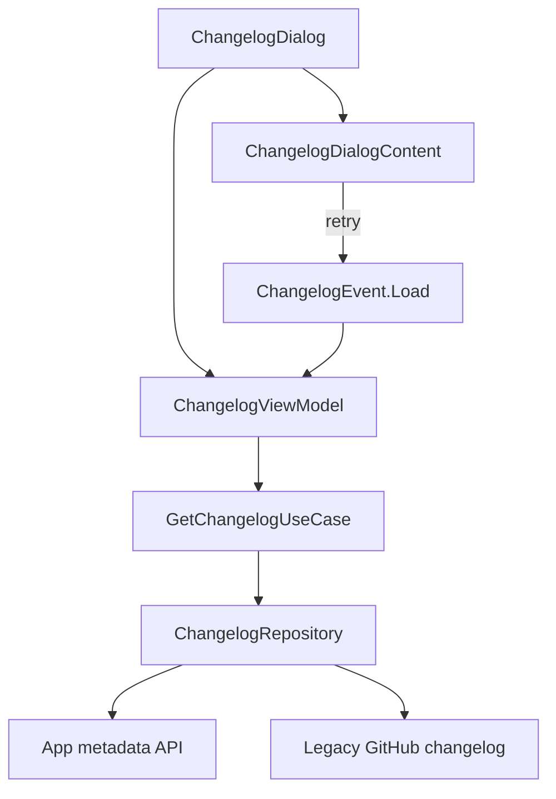

# `:library:feature:changelog` Logic Graph

## Purpose

Owns changelog retrieval and presentation: the package-aware Markdown fetch, its legacy fallback,
and the bottom sheet that renders it.

## Owns

- `ChangelogPreferencesDataSource` and its default in `data/local`, exposed for hosts through the
  shared settings file. The dialog fetches remotely and does not use the stored values.
- `ChangelogRepository` and `DefaultChangelogRepository`, including selection of the Android App Metadata API
  call and the legacy GitHub fallback.
- `GetChangelogUseCase`, which returns `ChangelogHistory` with the full Markdown and installed
  host version. `ui/transformers/` identifies releases and marks exact current-version matches.
- `ChangelogViewModel`, `ChangelogUiState` (whose `markdown` is a `Loadable`), and `ChangelogEvent.Load`,
  sent on start and on retry.
- `ChangelogDialog`, in `feature.changelog.ui`, the modal bottom sheet the host shows from its drawer,
  and the stateless `ChangelogDialogContent` it draws inside the sheet. The content draws each part of
  the Markdown on its own and the Toolkit's `HorizontalWavyDivider` where the Markdown has a rule
  (`splitAtThematicBreaks`), in place of the renderer's flat line. `ChangelogDialog(releasesUrl)`
  adds an info button beside the title that opens that page, such as
  `GithubConstants.APP_TOOLKIT_RELEASES`; without one the sheet shows no button.

## Does not own

- The drawer entry that opens the dialog, owned by
  [`:library:navigation`](../../navigation/README.md) and the host shell.
- In-app update triggering, owned by `:library:integration:update`.
- The About screen and its metadata, owned by [`:library:feature:about`](../about/README.md).

## Depends on

- `:library:core:common`, `:library:core:datastore`, `:library:core:network`, and
  `:library:core:ui` for shared state, persistence, HTTP, and Compose.
- `compose-markdown` to render the fetched Markdown.

## Used by

- `:library:apptoolkit` and `:sample`.

## Flow chart

## Architectural decisions

- The dialog is on `core.ui.screen`. `ChangelogRepository.getChangelog` returns the Markdown or throws a
  `NetworkException`, the use case passes a failure through, and `ChangelogViewModel` maps it with
  `toFailed`. Shared errors such as offline use their own text. The sheet shows Retry only when
  the failure is retryable. `ScreenHost` reports visits and load states, and `ifIsActive` keeps a
  fetch running when a duplicate load is requested. A changelog with nothing in it is
  `Loadable.Empty`, shown as no new updates. Neither the ViewModel nor the repository needs a
  dispatcher: Ktor suspends.
- The package endpoint is authoritative and the legacy URL is a compatibility fallback, used only
  when the package name is blank or the endpoint answers 404, so a host that has not been published
  to the metadata API still shows release notes.
- Heading selection and thematic-break splitting share a fence scanner. Backtick and tilde fences
  close only with the same marker, a sufficient run length and a blank suffix. Code examples do
  not create version boundaries or dividers.
- The sheet always shows the full history. A localized Current label identifies the installed
  release, including a match in a grouped version line. It opens at that release and preserves
  scrolling across configuration changes. If no version matches, it opens at the beginning.
- The sheet keeps its header and action fixed while a lazy list scrolls through releases. The
  reading padding belongs inside the list, so its viewport reaches the Done action area.
- Shared button labels come from `:library:core:ui` rather than being duplicated here.

## Public contracts

- `ChangelogPreferencesDataSource` and its default in `data/local`, using the shared settings file.
- `ChangelogRepository`, `GetChangelogUseCase`, `ChangelogHistory`, `ChangelogViewModel`, `ChangelogUiState`,
  `ChangelogEvent`, `ChangelogDialog`, and `changelogModule`. `ChangelogDialogContent` is internal.

## Internal implementations

- HTTP fetch in `data/remote/ChangelogRemoteDataSource`, its `data/remote/models/MarkdownResponse`,
  status-to-`NetworkException` mapping, fallback selection, and Markdown rendering.

## Current risks

The legacy fallback keeps a second source of truth alive. Until every host is published to the
metadata API, a 404 silently changes which document the user reads.

## Markdown ownership

Release parsing and thematic-break splitting live in `ui/transformers/`. Both use the fence
scanner in `utils/`. `GetChangelogUseCase.invoke()` now returns `ChangelogHistory`; direct callers
read its `markdown` and `currentVersion` properties.
`DefaultChangelogRepository` takes `ChangelogRemoteDataSource` directly instead of an HttpClient.
Callers constructing the repository directly must update that argument; the feature's Koin module
supplies it automatically.
