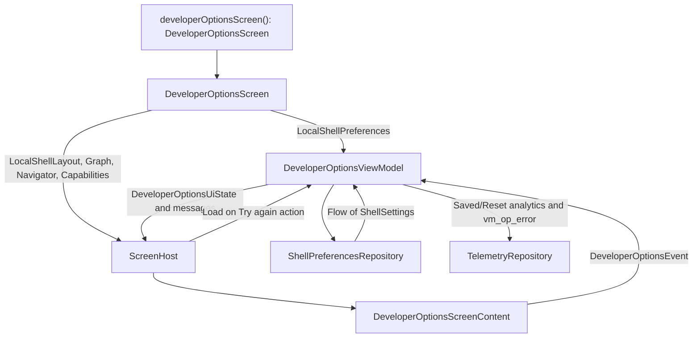

# `:library:feature:developer` Logic Graph

## Purpose

The developer options page, the shell's laboratory: every override that forces, compares or
exercises the shell's layout, bars, navigation, motion and accessories, applied while the app runs,
and a live readout of the state the shell is in. Changes apply at once and persist, so the app can
be restarted into a variation. The person's own preferences are display settings instead, in
[`:library:feature:display`](../display/README.md).

## Owns

- `DeveloperOptionsScreen`, with its headings and rows:

  | Heading | Row | Shown when |
  |---|---|---|
  | Live state | Window, page stack | always |
  | | One stack per tab | per tab |
  | Layout and bars | Forced layout | the app has tabs |
  | | App bar style, hide the app bar on scroll | the shell draws an app bar (`hasShellTopBars`) |
  | | Navigation bar style, hide the bottom bar on scroll | the app has bottom navigation tabs (`hasBottomNavigationTabs`) |
  | | Navigation tint | the app has tabs |
  | | Limit content width | the layout policy sets a maximum width |
  | Navigation | Where the app starts | more than one start option |
  | | Tab transition | more than one tab |
  | | Back swipe from the right | more than one destination |
  | Motion | Animation speed, entrance style, motion tempo, entrance replay | always |
  | Accessories | Bottom accessory | a banner or a player the tabs can show; all four choices with both, otherwise shown or hidden |

  A heading without a row is left out, and Reset is always last.
- `DeveloperOptionsScreenContent` in the screen file renders explicit values and reports edits
  through `DeveloperOptionsEvent`, with Compose previews in `DeveloperOptionsScreenPreview.kt`.
- `DeveloperOptionsViewModel`, `DeveloperOptionsUiState`, and `DeveloperOptionsEvent` apply edits
  and Reset through the host's `ShellPreferencesRepository`, report failures as snackbar messages,
  and record successful actions.
- `DeveloperOption`, `DeveloperCategory`, `availableDeveloperOptions(capabilities)`,
  `accessoryModes(capabilities)`, `effectiveAccessoryMode(mode, capabilities)`, and
  `developerOptionCategories(capabilities)`: which overrides act on something in this app and how
  single-accessory selections normalize to the available options.
- `DeveloperOptionItem`, the row of each override, and its option labels.
- `DeveloperStateLine` in `ui/models` and `DeveloperStateItem` in `ui/views` render live state.
- Capability filtering and category derivation live in `ui/transformers/`, display labels and stack
  text in `ui/formatters/`, stable operation names in `ui/constants/`, and the grouped row modifier
  in `ui/extensions/`.
- Screen identity (`DEVELOPER_OPTIONS_SCREEN`) and successful option/reset event builders live in
  `ui/analytics/`. Parameters contain bounded option keys, with no host names, stack text or
  selected values.
- `developerOptionsScreen()`, the registration of `DeveloperOptionsScreen`, and
  `developerOptionsModule`.
- Its strings, in every supported locale, including the page title `shell_developer_options` and
  the override rows' titles and options.

## Does not own

- The settings it edits, owned by [`:library:shell`](../../shell/README.md) (`ShellSettings`,
  `ShellPreferencesRepository`).
- What the app's shell can show, `ShellCapabilities`, owned by
  [`:library:navigation`](../../navigation/README.md) and provided by `ShellHost`.
- Adding the page to a graph, done by `toolkitScreens()` in
  [`:library:apptoolkit`](../../apptoolkit/README.md). An app replaces the page by registering
  `DeveloperOptionsScreen` itself.
- Where the page is offered. The advanced settings of
  [`:library:feature:advanced`](../advanced/README.md) list it once the About screen's version
  easter egg is found; an app may link to it elsewhere too.

## Host requirements

Render `DeveloperOptionsScreen` inside a `ShellHost` so the shell composition locals
(`LocalShellPreferences`, `LocalShellLayout`, `LocalShellNavigator`, `LocalShellGraph`,
`LocalShellCapabilities`) are provided. Hosts assembling Koin modules manually must include
`developerOptionsModule` before opening the page.

## Depends on

- [`:library:shell`](../../shell/README.md), as `api`, and through it
  [`:library:navigation`](../../navigation/README.md) and [`:library:core:ui`](../../core/ui/README.md),
  whose preference rows and dialog it draws with.

## Used by

- [`:library:apptoolkit`](../../apptoolkit/README.md).

## Flow chart

## Architectural decisions

- **Every shell override lives here.** Each `ShellSettings` value is a developer option: it forces
  a variation over what the app declares. None is a display setting, so a person never meets the
  shell's implementation choices.
- **Overrides count what a forced layout reaches.** Display rows follow the app's declared layout
  policy; these follow what the page itself can force. An app with tabs gets the bottom bar's and
  the rail's overrides whatever its width thresholds, since the forced layout row can show either.
  A host that enables `hideSingleTabBottomBar` keeps its one-tab bottom bar hidden even in a forced
  phone layout, so its bottom bar overrides are left out. Rows that have nothing to act on (a tab
  transition with one tab, a width limit the app never sets, accessories it does not declare) are
  left out.
- **Single-accessory selection normalization.** When a host declares only a banner or only a player,
  the Bottom accessory choice dialog offers only `AsDeclared` and `None`. `effectiveAccessoryMode`
  maps persisted `BannerOnly` or `PlayerOnly` values onto whichever offered option matches what the
  shell actually draws.
- **Not searchable.** The settings search does not list these overrides: the page is reached once
  unlocked, and a result would go around the unlock.
- **Reset is complete.** `ShellPreferencesRepository.resetDeveloperOptions()` forgets every saved
  `ShellSettings` choice, so the shell is again exactly as the app declares it in its
  `appToolkitDefaults { }`, or as the Toolkit's defaults without one. The person's preferences live
  in the common store and are not touched.
- **Every row saves a choice.** Picking a value saves it even when it equals the current default,
  so a later change to the app's defaults does not move it.
- The page passes the `ShellHost`'s `LocalShellPreferences` repository to `DeveloperOptionsViewModel`
  as a Koin parameter so state and writes always use the same store. A read failure keeps the last
  settings visible and offers Try again in the error snackbar when `error.isRetryable` is true.
  `Load` restarts observation, replacing the previous collector. `DefaultShellPreferencesRepository`
  translates storage read failures to `StorageException`, so read retries trigger for both the
  default store and custom host repositories.
- It uses the Toolkit's grouped preference rows and `ChoicePreferenceItem`, so it looks like the
  Toolkit's other settings pages.

## Public contracts

- `DeveloperOptionsScreen()`, `developerOptionsScreen()`, `developerOptionsModule`,
  `DeveloperOptionsViewModel`, `DeveloperOptionsUiState`, and `DeveloperOptionsEvent`. The
  assembled Toolkit graph includes the module. Hosts assembling modules manually include it before
  opening the page. `DeveloperOptionsScreenContent`, option models, transformers, formatters, and
  row composables are internal.

## Internal implementations

- `DeveloperOptionsTransformer.kt` filters applicable options by `ShellCapabilities`, groups them
  by `DeveloperCategory`, and normalizes single-accessory selections.
- `DeveloperOptionLabels.kt` and `NavigationStackFormatter.kt` format display labels and readable
  navigation stack traces.
- `DeveloperAnalytics.kt` owns `DEVELOPER_OPTIONS_SCREEN` and the bounded settings action builders.
- `DeveloperOptionsOperationNames.kt` owns stable ViewModel operation names for telemetry.

## Current risks

- Adding a field to `ShellSettings` requires updating `DeveloperOption`, `DeveloperOptionsEvent`,
  `DeveloperOptionsViewModel`, `DeveloperOptionsTransformer`, `DeveloperOptionItem`,
  `DeveloperOptionLabels`, and `DeveloperAnalytics` together so no override is silently omitted.
- `DeveloperOptionsViewModelTest`, `DeveloperOptionsTest`, `DeveloperAnalyticsTest`, and
  `NavigationStackFormatterTest` cover state transitions, capability filtering, analytics
  vocabulary, and stack formatting.
