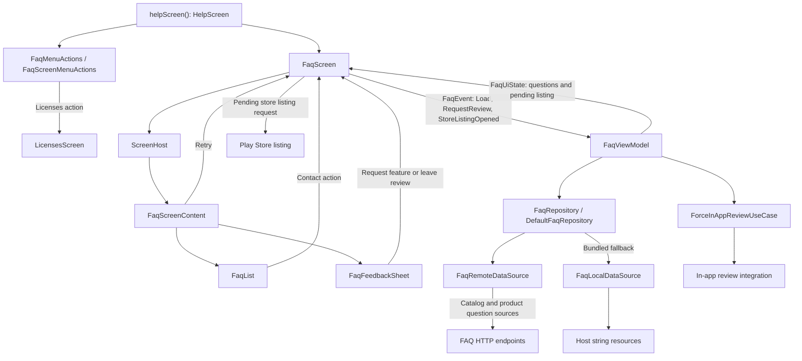

# `:library:feature:faq` Logic Graph

## Purpose

Displays the host's FAQ and provides contact, feedback and review actions. The module replaced
`:library:feature:help` in 3.0.0.

## Owns

- `helpScreen()`, which registers the `HelpScreen` key with `FaqScreen` and `FaqMenuActions`.
- `FaqViewModel`, `FaqUiState` and `FaqEvent` for question loading and review requests.
- Catalog lookup, question mapping and normalization, and the bundled resource fallback.
- The question list, contact card, feedback sheet and optional native ad row.

## Does not own

- Question and answer content, ad unit IDs or app identity. The host supplies them.
- HTTP client construction, owned by [`:library:core:network`](../../core/network/README.md).
- Review prompt implementation, owned by [`:library:integration:review`](../../integration/review/README.md).
- Open-source licenses, owned by [`:library:feature:licenses`](../licenses/README.md).

## Host requirements

- Use the Toolkit graph and host modules, or register `helpScreen()` and load
  `faqModule(hostBuildConfig)`. The build config selects the debug or release catalog and
  provides `faqProductId`, which matches a catalog product ID or key.
- The FAQ bindings use the host's Ktor client, diagnostics, telemetry and review use case.
  The app bar resolves `AppVersionInfo` to render the version dialog.
- Bind `AdsConfig` under `AdsQualifiers.HELP_NATIVE_AD`. Set `bannerAdUnitId` to a blank string
  to omit the ad row. The screen requires the binding even when ads are disabled. See
  [`:sample:integration:ads`](../../../sample/integration/ads/README.md).
- Supply localized bundled questions to support offline use. The module has nine pairs of
  resource slots, `question_1` through `question_9` and `summary_preference_faq_1` through
  `summary_preference_faq_9`. The library placeholders are empty and non-translatable so the
  host owns the copy. Entries with an empty question or answer are dropped. See
  [`:sample:feature:faq`](../../../sample/feature/faq/README.md).

## Depends on

- `:library:core:common`, `:library:core:datastore`, `:library:core:network` and `:library:core:ui`
  for shared configuration, ads preferences, networking and presentation.
- [`:library:navigation`](../../navigation/README.md) for the destination keys and shell graph.
- [`:library:integration:review`](../../integration/review/README.md) for the in-app review request.

## Used by

- [`:library:apptoolkit`](../../apptoolkit/README.md), which calls `helpScreen()` from
  `toolkitScreens()` and loads the FAQ bindings.
- The sample host supplies product configuration, fallback resources and the native ad binding.

## Flow chart

## Architectural decisions

- The catalog and screen share one feature module. `FaqViewModel` reads `FaqRepository`
  directly. The repository maps and normalizes both sources before checking for usable entries.
  Normalization trims the text, removes incomplete pairs and keeps the first occurrence of each ID.
- The remote result takes precedence when it has usable questions. Partial question source
  failures are skipped so remaining sources still load. If the catalog fetch or every configured
  question source fails and bundled content is unavailable, the repository propagates the failure.
  A successful read with no usable content shows the empty state.
- Ktor calls suspend and the fallback reads packaged strings. The repository is safe to call
  from the main thread.
- The first load and Retry use `FaqEvent.Load`. Duplicate requests retain the active load.
  Retry starts a new load after an empty result or a retryable failure.
- `FaqScreenContent` renders the load states and forwards interactions. `FaqList` owns visual
  expansion and Show more state. `FaqScreen` logs the callbacks and performs the link, mail and
  store actions. The feedback button remains available while questions load or fail.
- The screen retains the GA4 identity `Help`. It uses `select_content` for question, contact and
  feedback-option selections, and action events for buttons and app bar items.
- An unavailable or failed in-app review requests the Play Store listing. The ViewModel retains
  that request in `FaqUiState.openStoreListing` across configuration changes until the screen
  sends `FaqEvent.StoreListingOpened`.

## Public contracts

- `helpScreen()`, `FaqScreen`, `FaqMenuActions`, `FaqScreenMenuActions` and `faqModule` for
  host integration. The shared `HelpScreen` key lives in `:library:navigation`.
- `FaqViewModel`, `FaqUiState` and `FaqEvent` for the screen state and interactions.
- `FaqRepository`, `DefaultFaqRepository`, `FaqItem` and `FaqId` for question loading.
  The local and remote data sources and the remote catalog DTOs are also public.
- `FaqEndpointConstants` and `faqCatalogUrl` for catalog URLs. See the
  [3.0.0 migration guide](../../../docs/migration/3.0.0.md) for former import paths.
- `QuestionCard`, `ContactUsCard` and `FaqNativeAdCard` for standalone row rendering.

## Internal implementations

- `FaqScreenContent`, `FaqList`, `FaqFeedbackSheet`, catalog mappers and normalization.
- `FaqScreenPreview.kt` renders the screen content with sample state.

## Current risks

- The bundled fallback supports at most nine entries. Use the remote catalog for larger sets.
- A missing native ad binding prevents `FaqScreen` from composing. Use the blank-unit
  configuration when the host opts out.
