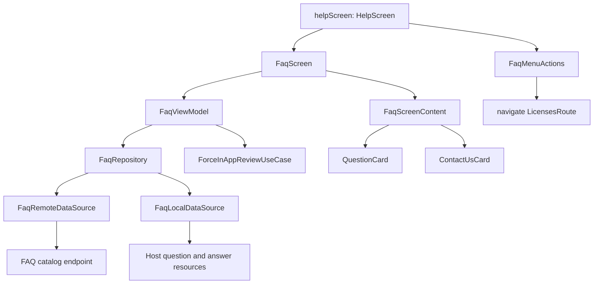

# `:library:feature:faq` Logic Graph

## Purpose

Owns the FAQ surface end to end: the catalog behind it, the screen that lists it, and the contact,
review, and store actions around it. This module replaced `:library:feature:help` in 3.0.0.

## Owns

- `FaqScreen` and the stateless `FaqScreenContent`, `FaqViewModel`, and their state and event
  contracts.
- `helpScreen()` in `ui/navigation/FaqNavigation.kt`, which registers `HelpScreen` with
  `FaqMenuActions` in the app bar.
- `FaqRepository` and `DefaultFaqRepository`, which normalize both sources, prefer the remote
  catalog, and fall back to the resources bundled in the host.
- `FaqRemoteDataSource`, `FaqLocalDataSource`, the catalog DTOs, and the DTO mappers under
  `data/remote/mappers`.
- `FaqItem` and `FaqId` in `data/models`, `QuestionCard`, `ContactUsCard`, `FaqNativeAdCard`, and
  the overflow menu.
- The nine question and nine answer placeholder resources a host fills in.
- `FaqEndpointConstants.FAQ_BASE_URL` in `data/constants/` and `faqCatalogUrl` in
  `data/extensions/`, which build the catalog address for the build type.

## Does not own

- Open-source licenses, owned by [`:library:feature:licenses`](../licenses/README.md); the overflow
  menu only navigates to `LicensesRoute`.
- In-app review implementation, owned by
  [`:library:integration:review`](../../integration/review/README.md).
- HTTP client construction, owned by [`:library:core:network`](../../core/network/README.md).
- Host identity strings, supplied as overridable defaults by `:library:core:common`.
- The questions and answers themselves, and the native ad unit. Both come from the host. See
  [Host requirements](#host-requirements).

## Host requirements

Two things the module renders but does not contain. Neither fails the build when it is missing, so
both are worth checking before shipping a host: the FAQ degrades silently at runtime, the ad
binding throws.

### The fallback FAQ, `question_1`–`question_9`

`FaqRepository` prefers the remote catalog and falls back to the bundled one whenever the remote
call throws or yields no questions, which also covers a catalog whose shape this module cannot map.
The bundled catalog is nine question/answer pairs read from host resources:

| Question             | Answer                          |
|----------------------|---------------------------------|
| `question_1`         | `summary_preference_faq_1`      |
| …                    | …                               |
| `question_9`         | `summary_preference_faq_9`      |

This module declares all eighteen as empty, untranslatable placeholders in
`res/values/untranslatable_strings.xml`, purely so it compiles on its own. They are slots, not copy:
the host declares the text and translates it, the way
[`:sample:feature:faq`](../../../sample/feature/faq/README.md) does. A host that does not gets a FAQ
screen with no bundled questions when the remote catalog is unavailable. Empty question or answer
slots are dropped before rendering.

### The FAQ native ad unit

`FaqScreen` resolves an `AdsConfig` from Koin under the `AdsQualifiers.HELP_NATIVE_AD`
qualifier. Unlike the FAQ strings this one is not optional: the lookup throws and the screen fails
to compose when no host has registered it, so every host must, the way `:sample:integration:ads`
does.

To opt out of the ad rather than the binding, register the config with a blank `bannerAdUnitId`.
The screen already skips the slot when the id is blank or the user has ads switched off.

## Depends on

- `:library:core:common`, `:library:core:datastore`, `:library:core:network`, and `:library:core:ui`
  for shared configuration, persistence access, networking, and UI.
- [`:library:navigation`](../../navigation/README.md) for the keys and the graph builder.
- [`:library:integration:review`](../../integration/review/README.md) for review prompts.
- No other feature module.

## Used by

- [`:library:apptoolkit`](../../apptoolkit/README.md), which calls `helpScreen()` from
  `toolkitPages()`, and `:sample:feature:faq`, which fills in the questions.

## Flow chart

## Architectural decisions

- The catalog and the screen live in one module because they have no independent consumers: nothing
  renders the FAQ but this screen, and nothing uses this screen without the FAQ. Splitting them
  bought a module boundary and no separation.
- The placeholder resources are declared `translatable="false"` and left empty on purpose. Marking
  them translatable would make lint demand 25 translations of an empty string, and
  `MissingTranslation` is an error in this project.
- A host adds or rewords a question by changing its own FAQ module alone. Nothing in the library
  moves, which is the reason the content is not declared here.
- There is no FAQ use case. Cleaning the catalog is transforming a data-source model into an
  application model, which is repository work, and the one thing a use case would have added is a
  layer the single caller does not need. `FaqViewModel` reads `FaqRepository` directly.
- The screen is on `core.ui.screen`. `FaqRepository.getFaq()` returns the questions or throws, and
  `FaqViewModel` maps a failure with `toFailed`, so an offline device sees the offline text and
  anything else the FAQ's own. Neither needs a dispatcher: Ktor suspends, and the bundled questions
  are string resources.
- A failed question source is skipped so other sources can still supply questions. When a catalog
  fetch fails and there are no bundled questions, the repository propagates the failure. An empty
  result shows `Loadable.Empty` with Retry.
- `FaqScreenContent` logs nothing and opens nothing. Every tap reaches `FaqScreen` as a named
  callback, which logs GA4 events (`select_content` for content selection, action events for buttons
  and overflow menu items) and opens the form, mail or store listing, since those need a `Context`.
- An unavailable or failed in-app review falls back to the Play Store listing. The ViewModel keeps
  the request in `openStoreListing` across configuration changes until the screen sends
  `StoreListingOpened`.
- The screen registers its feedback button with `ScreenHost`. The button stays available while
  questions load or fail. The screen preview lives in `FaqScreenPreview.kt`.
- Repeated requests to load the same catalog keep the active fetch. After a failure, Retry starts
  a new fetch.
- Normalizing inside the repository, before the emptiness check rather than after it, is what makes
  the fallback correct: a remote catalog of nothing but blank rows now counts as empty and falls
  through to the local questions instead of rendering blank rows.

## Public contracts

- `FaqScreen`, `helpScreen()`, `FaqMenuActions`, `FaqViewModel`, `FaqUiState`, `FaqEvent`,
  `FaqRepository`, `FaqItem`, `FaqId`, `QuestionCard`, and `faqModule`. `FaqScreenContent` is
  internal.
- `FaqEndpointConstants` and `faqCatalogUrl` are exposed in `data/constants/` and
  `data/extensions/` respectively. See the [3.0.0 migration guide](../../../docs/migration/3.0.0.md)
  for the former import paths.

## Internal implementations

- Catalog HTTP fetch, DTO mapping, local resource loading, the remote-then-local fallback, and the
  screen's ad slot and overflow menu.

## Current risks

The nine slots are a fixed count. A host with more or fewer questions has to supply them through the
remote catalog instead, because the local fallback is pinned to those resource names.
