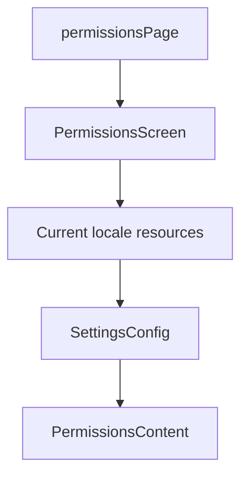

# `:library:feature:permissions` Logic Graph

## Purpose

Displays a localized explanation of the permissions used by AppToolkit hosts.

## Owns

- `PermissionsScreen`, the static permission catalogue and screen tracking.
- `permissionsConfig()`, an internal composable that resolves existing resource IDs against the
  current configuration, and `PermissionsContent`, the stateless grouped catalogue renderer.
- `permissionsPage()`, the registration of `PermissionsRoute`.

## Does not own

- The privacy page that links here, owned by [`:library:feature:privacy`](../privacy/README.md).
- The screen Android's permission manager opens, owned by `PermissionUsageActivity` in
  [`:library:apptoolkit`](../../apptoolkit/README.md).
- Runtime grant inspection or system-settings actions. This page is descriptive and does not
  claim to report current grant state.

## Depends on

- `:library:core:common` and `:library:core:ui` for presentation models, tracking and shared rows.
- [`:library:navigation`](../../navigation/README.md) for the route and graph builder.
- No other feature module.

## Used by

- `:library:apptoolkit`, which calls `permissionsPage()` from `toolkitPages()`.

## Flow chart

## Architectural decisions

- The page is `PaneRole.None`: opening it from the privacy detail stacks a page rather than
  replacing the privacy pane.
- The catalogue is presentation data. No repository, ViewModel, loading state, retry job or
  dependency-injection module is needed to render fixed resource-backed descriptions.
- `stringResource` runs in composition, so a configuration change resolves the new language
  without relying on a retained ViewModel to reload strings.
- Screen-view tracking and the ready screen-state event keep the existing Permissions identity.
- The public `PermissionsContent` still accepts a host-built `SettingsConfig`.

## Public contracts

- `PermissionsScreen`, `PermissionsContent`, and `permissionsPage()`.

## Internal implementations

- Localized catalogue assembly and grouped row rendering, in `ui/PermissionsScreen.kt`.
- `PermissionsLocaleTest` in `:sample:app` verifies English-to-Romanian resource updates without
  recreating the screen. It passed on the API 37 emulator.

## Current risks

The catalogue is descriptive and fixed at build time: adding a manifest permission requires updating
its descriptions separately. It is not an inventory of the host's actual manifest.

## Migration notes

`PermissionsRepository`, `DefaultPermissionsRepository`, `PermissionsViewModel`, `PermissionsUiState`,
`PermissionsEvent` and `permissionsModule` were removed. Hosts using `appToolkitModules` need no
registration change. Hosts assembling the graph manually must remove `permissionsModule` and call
`PermissionsScreen()` through the existing page registration. See the
[3.0 migration guide](../../../docs/migration/3.0.0.md).
