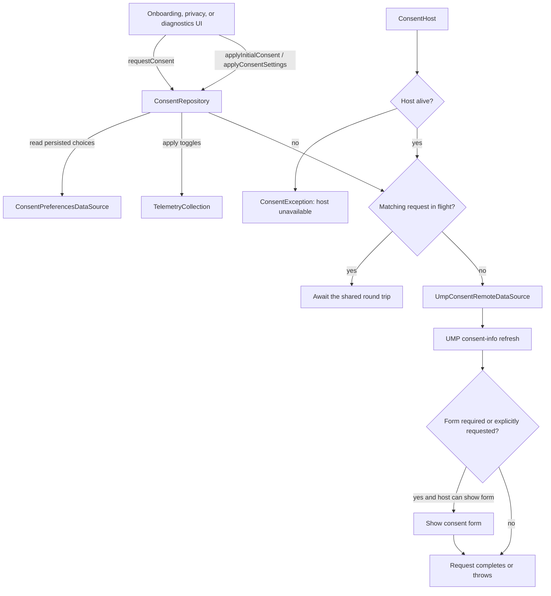

# `:library:integration:consent` Logic Graph

## Purpose

Coordinates user consent state between persisted toolkit preferences and Google's User Messaging
Platform (UMP).

## Owns

- `di.consentModule()` binds the consent repository and UMP remote source; foundation providers and
  preferences are supplied by the composing host graph.
- Consent models in `data/models`, host availability extensions in `data/extensions`, and the
  repository contract covering apply/request.
- `DefaultConsentRepository` and the UMP remote data source abstraction/implementation.
- Mapping host availability into consent behavior.

## Does not own

- Ads loading/presentation, owned by `:library:integration:ads`.
- Diagnostics screen UI, owned by `:library:feature:diagnostics`.
- Preference storage implementation, owned by `:library:core:datastore`.

## Depends on

- [`:library:core:common`](../../core/common/README.md) for dispatchers, build info, and telemetry
  contracts.
- [`:library:core:datastore`](../../core/datastore/README.md) for consent preference persistence.

## Used by

- `:sample` and `:library:apptoolkit`.
- `:library:feature:about`, `:library:feature:onboarding`, `:library:feature:startup`, and
  `:library:feature:settings` for privacy/diagnostics flows.
- `:library:integration:ads` before enabling ads.

## Flow chart

## Architectural decisions

- `ConsentPreferencesDataSource.settings(default)` reads every choice from one Preferences
  emission. Diagnostics uses the same snapshot contract, and bulk writes must be atomic.
- Matching callers await the same consent round trip. `requestConsent()` completes after the
  request succeeds or throws its failure, without emitting loading or result states.
- `showIfRequired` is part of the in-flight key because an explicit privacy-form request cannot be
  satisfied by a weaker conditional request.
- Host validity (`isAlive`, checking finishing, destroyed, and configuration changes) is verified
  before SDK work and after reading the AdMob app id; `canShowConsentForm` is checked again
  immediately before form display. Asynchronous callbacks complete at most once via an atomic guard
  and must not retain permission to use a destroyed activity.
- `InFlightConsentRequest` tracks the active host through a `WeakReference`, and `consentModule()`
  registers `onClose` so Koin teardown cancels the repository's owned round-trip scope.
- `HOST_UNAVAILABLE` leaves consent unresolved. Automatic activity-resume callers should keep a
  breadcrumb and allow a later resume to retry, rather than recording the lifecycle interruption
  as a nonfatal or permanently marking the session complete. The sample's
  [`MainViewModel`](../../../sample/app/README.md#architectural-decisions) demonstrates this policy.
  Explicit privacy-form actions retain their own user-visible error handling.
- Persistence records the resolved choice, while UMP remains the authority for whether a form is
  currently available or required.

## Public contracts

- `ConsentRepository`, `ConsentSettings`, `ConsentHost`, and `data.extensions.ConsentHostAvailability`
  (`ConsentHost.isAlive`, `ConsentHost.canShowConsentForm`).
- `ConsentHost(activity)`, which builds the host from the activity a page reads from
  `LocalActivity.current`. It replaced About's `GmsHostFactory`.

## Internal implementations

- `DefaultConsentRepository` and `UmpConsentRemoteDataSource`.

## Current risks

Consent behavior spans persistence, host callbacks, UMP state, Firebase toggles, and ads consumers;
changes require coordinated validation across those boundaries.

Requests with different `showIfRequired` values wait for the current round trip before starting
another. A stale-host wait is limited to five seconds; a timeout fails the waiting caller without
starting overlapping SDK work. The active operation stays tracked until it answers.

## Migration notes

### Fixed: UMP 4.0.0 empty-error-body process crash

Reported as `NoSuchElementException` from `Scanner.next()` on a UMP `ThreadPoolExecutor` thread,
with no toolkit frame in the stack.

The toolkit previously encountered a process-killing failure after a consent request failed. UMP
4.0.0 performs a metrics request on its own executor and reads a non-success response body with
`Scanner.next()`. An empty body throws `NoSuchElementException` on that executor thread. Because the
throw happens outside the toolkit coroutine/callback path, catches in the remote source or the
repository cannot intercept it.

Keep these host checks, request-mode distinctions, and shared-result behaviors when changing UMP
coordination:

- `DefaultConsentRepository` shares a round trip between matching callers.
- The in-flight request is keyed by `showIfRequired`; an explicit form request must not join a
  request that only shows a form when required.
- A host that is finishing, destroyed, or changing configurations is rejected before UMP is called.
- `UmpConsentRemoteDataSource` checks `ConsentHost.canShowConsentForm` again in the asynchronous
  callback before displaying a form.
- Every starter or joining caller awaits completion or receives an exception. Cancelling one
  caller's wait does not cancel the shared round trip for other callers.
- UMP receives an AdMob application ID only when the host-manifest provider resolves a valid value;
  there is no library fallback ID.

[`ConsentSdkCrashGuard`](../../core/common/README.md) narrowly covers any remaining SDK telemetry
failure. Remove that guard only after the exact empty-body read is verified as fixed in the released
UMP artifact, preferably by inspecting the artifact rather than relying only on release notes.
