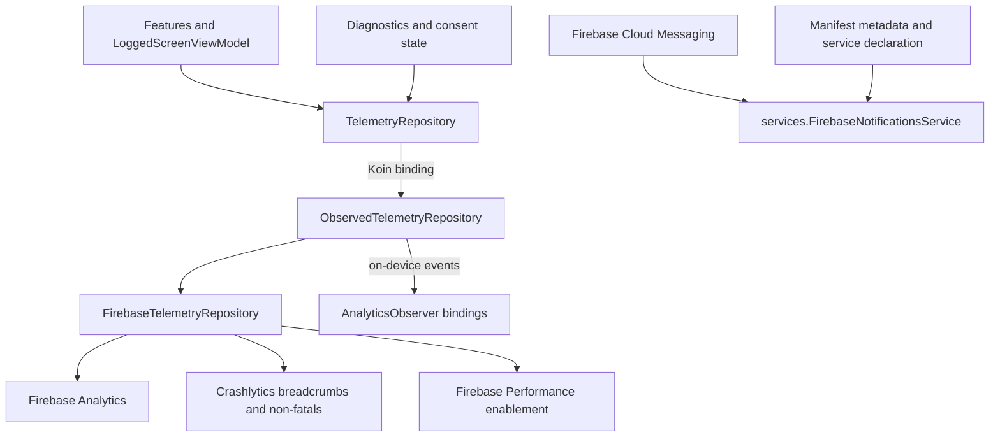

# `:library:integration:firebase` Logic Graph

## Purpose

Implements the toolkit's Firebase analytics/crash-reporting contract and provides Firebase messaging
service wiring.

## Owns

- `data.repositories.FirebaseTelemetryRepository` for analytics events, breadcrumbs, and crash
  reporting, with internal consent-status mapping in `data.mappers`.
- `firebaseModule` Koin bindings. Its `TelemetryRepository` is `FirebaseTelemetryRepository` inside an
  `ObservedTelemetryRepository`, so every event also reaches the app's bound `AnalyticsObserver`s.
- `services.FirebaseNotificationsService` and the module's Firebase manifest metadata defaults.

## Does not own

- The SDK-neutral `TelemetryRepository` contract, owned by `:library:core:common`.
- User consent decisions and persisted diagnostics preferences, owned by consent/settings/DataStore
  modules.

## Depends on

- [`:library:core:common`](../../core/common/README.md) for the `TelemetryRepository` contract and shared
  analytics values.

Firebase Analytics, Crashlytics, Performance, and Messaging materially define this module.

## Used by

- `:sample` and `:library:apptoolkit` to install the production Firebase implementation.

## Flow chart

## Architectural decisions

- Features depend on the SDK-neutral contracts in `core.common.telemetry`; only this module imports
  concrete Firebase products for telemetry. `FirebaseTelemetryRepository` implements all of them as
  one `TelemetryRepository`, bound once, and `telemetryModule` hands the same instance out as
  `AnalyticsReporter`, `DiagnosticsReporter` and `TelemetryCollection`, so Firebase is set up once.
- Consent updates reach the SDKs through `TelemetryCollection`, applied by the consent owners
  only, so enablement policy does not leak into every feature.
- Manifest metadata defaults fail closed at cold start (`firebase_crashlytics_collection_enabled`
  and all four `google_analytics_default_allow_*` flags default to `false`) so debug builds and
  opted-out users do not collect data before `ConsentRepository.applyInitialConsent()` applies
  persisted choices. Automatic GA4 Activity screen reporting is disabled because `ScreenHost` logs
  Compose screens explicitly, and `firebase_performance_logcat_enabled` is omitted from the main
  manifest so release builds do not emit Performance URLs and traces to Logcat.
- `FirebaseTelemetryRepository` guards SDK lookups against uninitialized `FirebaseApp` instances so
  error reporting never masks the original failure, rejects overlong user property names instead of
  truncating them, drops blank screen names and non-finite doubles, and preserves canonical
  `view_model` and `action` keys in ViewModel error reports.
- This module is the deliberate exception to the rule that `data/` code reports no analytics:
  it is the transport that sends them. `checkModuleBoundaries` names it as such.
- Messaging remains a framework-created service in `services/` and is wired through the manifest
  rather than the Koin-created repository lifecycle. It logs non-identifying lifecycle state only and
  does not display notifications itself; hosts that handle custom data payloads can replace it.

## Public contracts

- `firebaseModule` and `services.FirebaseNotificationsService` declared in the manifest.

## Internal implementations

- Firebase SDK calls, consent status mapping, and default FCM service callbacks.

## Current risks

The module bundles several Firebase products, so hosts cannot currently select analytics, crash
reporting, performance, and messaging independently at the module boundary. Because
`firebase-messaging` is bundled, its merged manifest brings in `POST_NOTIFICATIONS` and `WAKE_LOCK`.
