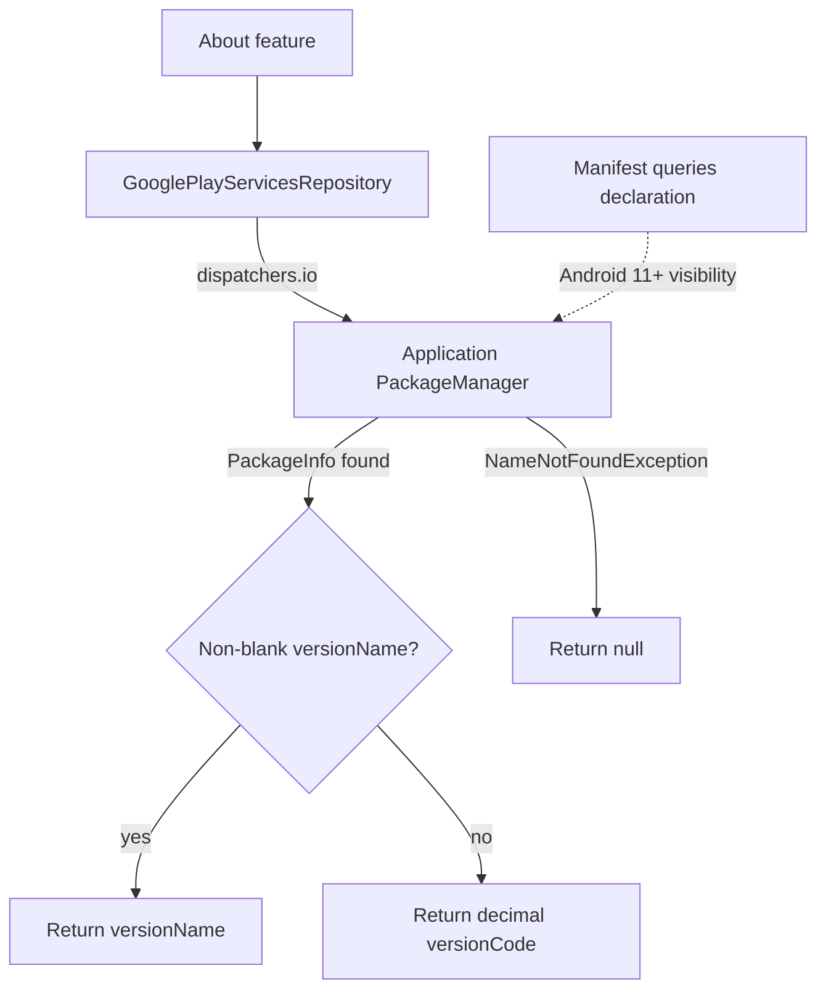

# `:library:integration:gms` Logic Graph

## Purpose

Exposes installed Google Play services metadata through a main-safe repository.

## Owns

- `GooglePlayServicesRepository` and `DefaultGooglePlayServicesRepository`.
- `googlePlayServicesModule`, which binds one repository using the host context and
  `DispatcherProvider`.
- The package lookup for `com.google.android.gms`, including version-name and version-code fallback.
- The `<queries><package android:name="com.google.android.gms" /></queries>` manifest declaration
  merged into consuming applications for Android 11+ package visibility.

## Does not own

- About screen rendering or assembly of host application metadata.
- Firebase, advertising, consent, or other Google SDK lifecycles.

## Depends on

- [`:library:core:common`](../../core/common/README.md) for dispatcher and DI infrastructure. No
  Google SDK dependency is required.

## Used by

- `:library:feature:about` to assemble `AboutInfo`.
- `:library:apptoolkit`, which exports the module and includes its Koin binding in
  `appToolkitFoundationModules`.

## Flow chart

## Architectural decisions

The repository reads PackageManager on the injected IO dispatcher. Callers do not switch dispatchers.
It retains the application PackageManager rather than an activity context.

## Public contracts

- `suspend GooglePlayServicesRepository.getVersion(): String?`: the installed version name, the
  decimal version code when the name is null or blank, or null when the package is absent or not
  visible to the host.
- Unexpected platform failures propagate; cancellation is not converted into an absent package.
- Standalone consumers load `googlePlayServicesModule` and supply a context and `DispatcherProvider`.
  Hosts using `appToolkitModules` already receive the binding.

## Internal implementations

Android package lookup uses the typed flags API from API 33 and the long version code from API 28.

## Current risks

Although the module merges `<queries>` for `com.google.android.gms`, device policy or work-profile
restrictions can still affect package visibility. A null result describes the package lookup, not a
check of whether every Google API is usable.
