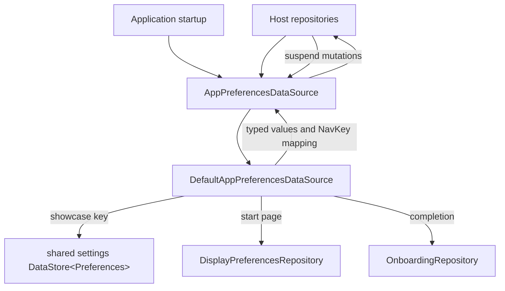

# `:sample:core:datastore` Logic Graph

## Purpose

The host's preference storage: everything the sample persists beyond what the toolkit already
stores.

## Owns

- `AppPreferencesDataSource` and `DefaultAppPreferencesDataSource`, covering the components-showcase
  unlock flag, which two sample features share, and the host's startup state and destination.

## Does not own

- Toolkit preferences, owned by their shared core, feature or integration modules.
- Any decision about what the stored values mean; that belongs to the repositories that read them.
- Favorites, owned by `:sample:feature:apps`, the only feature that reads them.

## Depends on

- [`:library:core:datastore`](../../../library/core/datastore/README.md) for shared preferences.
- Core common's `OnboardingRepository` contract for startup completion, and core DataStore's
  `DisplayPreferencesRepository` for the stored start page, with no feature dependency.
- [`:library:navigation`](../../../library/navigation/README.md) for Navigation 3's `NavKey`, the
  type the stored start page maps to. Startup projection uses core DataStore directly; this module
  has no direct core:ui dependency.

## Used by

- `:sample:feature:apps`, `:sample:feature:components`, `:sample:feature:settings`, `:sample:app`.

## Flow chart

## Architectural decisions

- The sample keeps its own keys in the toolkit's single preferences file, through the graph's
  `DataStore<Preferences>`, and exposes them through `AppPreferencesDataSource`.
- Persisted routes remain strings at the storage boundary and are mapped to `NavKey` values by
  a caller-supplied function, keeping host route knowledge out of the toolkit DataStore.
- The contract groups sample-wide preference access because there is one implementation and one
  backing store; feature repositories still own the meaning of each value.

Startup mapping delegates to core DataStore's generic startupValueFlow with the caller-supplied
mapping; `:sample:app`'s `startKeyFor` maps each stored value to a tab.

## Public contracts

- `AppPreferencesDataSource`.

## Internal implementations

- Preference keys and the DataStore instance.

## Current risks

The showcase key shares the settings file with the toolkit's keys; keep its name stable.
