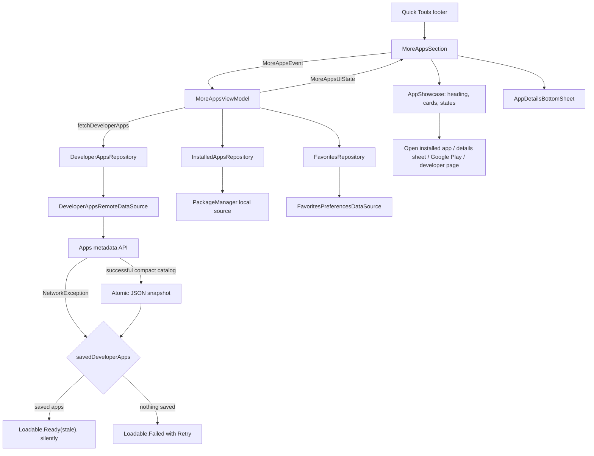

# `:sample:feature:apps` Logic Graph

## Purpose

The developer's app catalogue as "More apps", the last section of Quick Tools: the apps, their
details, favorites and install state.

## Owns

- App interaction event builders in `ui/analytics`, and the reporting launcher in `ui/utils`.
- App-card launching through the Toolkit's `InstalledAppsRepository` and `AppLauncher`; the sample
  keeps its Play Store fallback when a package is absent or cannot be launched.
- `DeveloperAppsRepository`, `FavoritesRepository` and their `Default` implementations.
  Installed-package queries use the Toolkit's `InstalledAppsRepository`.
- `FavoritesPreferencesDataSource`, the favorited package names under the `favorite_apps` key of
  the shared settings file.
- `DeveloperAppsRemoteDataSource`, which owns Ktor requests and DTO decoding, and throws a
  `NetworkException` for an error status.
- `DeveloperAppsLocalDataSource`, which persists the last successfully downloaded compact
  catalogue as an atomic JSON file. PackageManager access belongs to the Toolkit repository.
- `MoreAppsViewModel`, `MoreAppsUiState`, `MoreAppsEvent`, and `MoreAppsSection` with its
  stateless `MoreAppsSectionContent`, which draws the library's `AppShowcase` and the details sheet.
- What a tap does: an installed app opens; one that is not opens its details sheet, whose Play
  Store action installs it. A card's button opens the app or its store page, and "View all" opens
  the developer's page on Google Play.
- Localized strings, and `ui/mappers/MoreAppsErrorMappers.kt`, which gives each failure the shared
  `toUiText` text or the feature's fallback.
- `MoreAppsIcon`, the Material Symbols Rounded "apps" icon of the section's title.
- The Get it on Google Play badge the detail sheet shows, and the sheet's own native ad.

## Does not own

- Where the section sits: `:sample:app` passes `MoreAppsSection` as Quick Tools' `footer`, since
  `:sample:feature:tiles` may not depend on this module.
- The carousel and cards, `AppShowcase` in [`:library:core:ui`](../../../library/core/ui/README.md),
  which owns no data and opens nothing.
- Widget rendering, owned by [`:sample:widget`](../../widget/README.md), which reads this module's
  repository.

## Depends on

- `:sample:core:analytics`, `:library:core:datastore` and `:sample:integration:ads`.
- [`:library:apptoolkit`](../../../library/apptoolkit/README.md) for ad slots, `core.ui.screen`,
  `networkCall`, `storageCall` and Ktor.

## Used by

- `:sample:widget` for the catalogue and favorites, and `:sample:app`, which registers the module
  and places `MoreAppsSection` at the end of Quick Tools.

## Flow chart

## Architectural decisions

- The remote catalog is authoritative; the atomic JSON snapshot exists for offline/stale fallback
  and is replaced only after a successful decode.
- Corrupt snapshots are deleted and treated as misses so malformed cached data cannot create a
  permanent failure loop.
- Installed state and favorites have separate repositories because PackageManager and preferences
  are independent sources with different lifetimes.
- Action and chip models are presentation transformations and remain outside the source-neutral
  repositories.
- The section shows no ads of its own and triggers no app-open ad; the details sheet keeps the one
  it had.
- Package-name copying uses the Toolkit's `ClipboardRepository`, as About does. The Apps toast is
  shown only when the system does not confirm copies itself, on Android 12L and earlier. Android
  13 and later use only the system confirmation.
- The repositories return data or throw: `NetworkException` through `networkCall`, and
  `StorageException` through `storageCall` for the saved catalogue and the favorites. The feature
  throws no exceptions of its own.
- The ViewModel, not the repository, falls back to the saved catalogue. The section is a footer,
  so it shows the saved copy without a message of its own. A failed favorite update keeps the
  section and shows a message.
- Opening an app needs a `Context`, so the section does it, through `rememberOpenAppAction`, which
  falls back to the store page when the app cannot be launched.
- It reports as part of Quick Tools: `app_card_interaction` from the `more_apps` source, the
  sheet's actions from `app_details`, and `select_content` for the developer page.

## Installed-package metadata

The Toolkit's `InstalledAppsRepository` supplies batch installation checks and `AppInstallInfo`.
Version details stay in the existing `AppVersionMetadata` form, with no sample-only copy or mapper.
The details launcher also uses this repository for launch intents and API 33+ launch tokens, then
opens Android activities on the UI coroutine. A missing or denied lookup keeps the Settings fallback.

## Public contracts

- The three repositories, `MoreAppsViewModel`, `MoreAppsSection`, `AppSummary`/`AppDetails`.

## Internal implementations

- Remote DTO mapping, local cache-model mapping and serialization, and PackageManager inspection.

## Source of truth and failure behavior

The remote endpoint remains authoritative. Each successful compact-catalogue response atomically
replaces the local JSON snapshot; a failed write is reported to Crashlytics and does not fail the
fetch. `fetchDeveloperApps` throws when the download fails, and `savedDeveloperApps` reads the
snapshot without the network, so the section and the widget both stay useful offline. Corrupt
snapshots are deleted and treated as cache misses.

## Current risks

The module applies the Kotlin serialization plugin because its DTOs are `@Serializable`. Compiling
without it succeeds and fails only at decode time, so the plugin has to stay even though nothing
about the source makes the dependency visible.

## Migration notes

The Apps page and its drawer link are gone: the catalogue is "More apps" at the end of Quick
Tools. `AppsListScreen`, `AppsListViewModel`, `AppListUiState`, `HomeEvent`, `AppsListFilter`,
`AppsListRoute`, the grid with its filter chips, search and random-app button, the list's native
ads (`AppAdsQualifiers.APPS_LIST_NATIVE_AD`, `AdsConstants.APPS_LIST_NATIVE_AD_UNIT_ID` and
`APPS_LIST_AD_FREQUENCY`) and sharing from a card were removed. The repositories, the cache,
favorites and the widget's dependencies are unchanged. An install whose startup page was the Apps
page (`apps_list`) opens Quick Tools.

`AppsListViewModel` used to take six pass-through use cases wrapping these three repositories. It
now
takes the repositories; the use cases added a duplicated breadcrumb and nothing else.

The screen moved from `core.ui.base` to `core.ui.screen`. `DeveloperAppsRepository` no longer
returns `DataState`: its calls are `suspend` and throw, and `AppErrors` and `HomeAction` are gone.
`AppsListScreen()` takes no parameters; it pads by `contentPadding()` and reads the window size
class itself. The ViewModel no longer takes a `DispatcherProvider`.

Navigation keys and the complete graph live in `:sample:app` under `app/navigation`.
Features expose callbacks rather than importing app-owned route keys.
