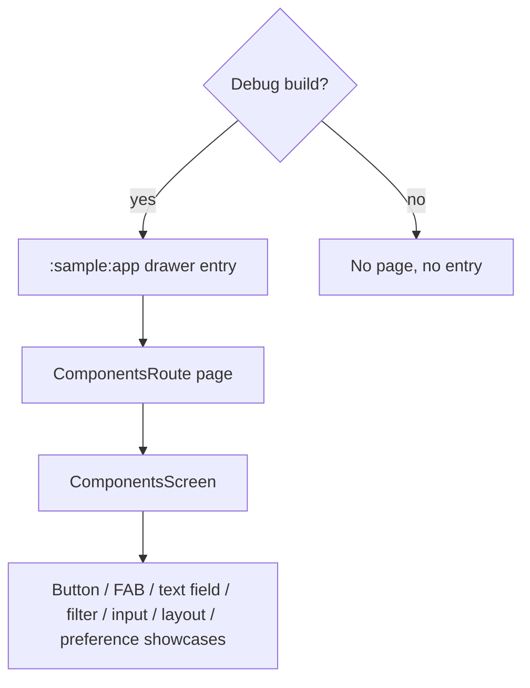

# `:sample:feature:components` Logic Graph

## Purpose

The components showcase, a debug-only page for checking the Toolkit's components on a device.

## Owns

- `ComponentsScreen`. `ComponentsRoute` belongs to app/navigation.
- Localized strings for the component showcase.
- The article app bar demo: `ArticleBarShowcase` opens `ArticleDemoRoute`, a made-up article
  (`ArticleDemoScreen`) that declares `ScaffoldArticleTopBar`, without a brand or with
  `components_article_brand`, a multicoloured vector mark drawn for this sample.
- The `GeneralTextField` gallery: one card per variant, including the error state and the Markdown
  editor. The text typed into it is the showcase's own scratch state and stays inside the section.
- The animation playground for bundled DesignSystem AVDs: a replay-mode menu, a Loop checkbox, and
  the menu that chooses whether a loop starts right away or on the first tap. Changing a control
  resets preview state; previews animate only on taps until a loop is started.
- The snackbar examples, inside the buttons section rather than a section of their own: each group
  of buttons shows one kind through `rememberScaffoldSnackbars()`. Standard buttons show a plain
  message, tonal ones a message with an Undo action, outlined ones the error style with Retry, text
  and icon buttons an icon with colours of its own, and the size groups a snackbar the screen draws
  itself through `content`.

## Does not own

- Whether the page exists: `:sample:app` registers it, and its drawer entry, only in debug builds.
- The page registration and the drawer entry, both in `:sample:app`'s `appGraph`, and drawer
  rendering, owned by [`:library:shell`](../../../library/shell/README.md).

## Depends on

- `:sample:core:analytics`.
- [`:library:apptoolkit`](../../../library/apptoolkit/README.md) for the screen and state contracts.

## Used by

- `:sample:app`, which registers `ComponentsScreen` as a page of its graph.

## Flow chart

## Architectural decisions

- This UI showcase has no `domain` or `data` package: it only renders components.
- It is a developer page, so release builds do not register it. There used to be an About
  version-tap unlock that showed it in release builds; it was removed with the flag it stored.
- The shell never sees this feature: it renders whatever drawer entries the app's graph declares.

## Public contracts

- `ComponentsScreen`. The route and the drawer entry are assembled by `:sample:app`.

## Internal implementations

- The showcase screen content.

## Migration notes

`ComponentsShowcaseRepository`, `componentsModule` and the `components_showcase_unlocked`
preference were removed with the About unlock. An install that had unlocked the page keeps the
stale preference, which nothing reads.

Navigation keys and the complete graph live in `:sample:app` under `app/navigation`.
Features expose callbacks rather than importing app-owned route keys.
