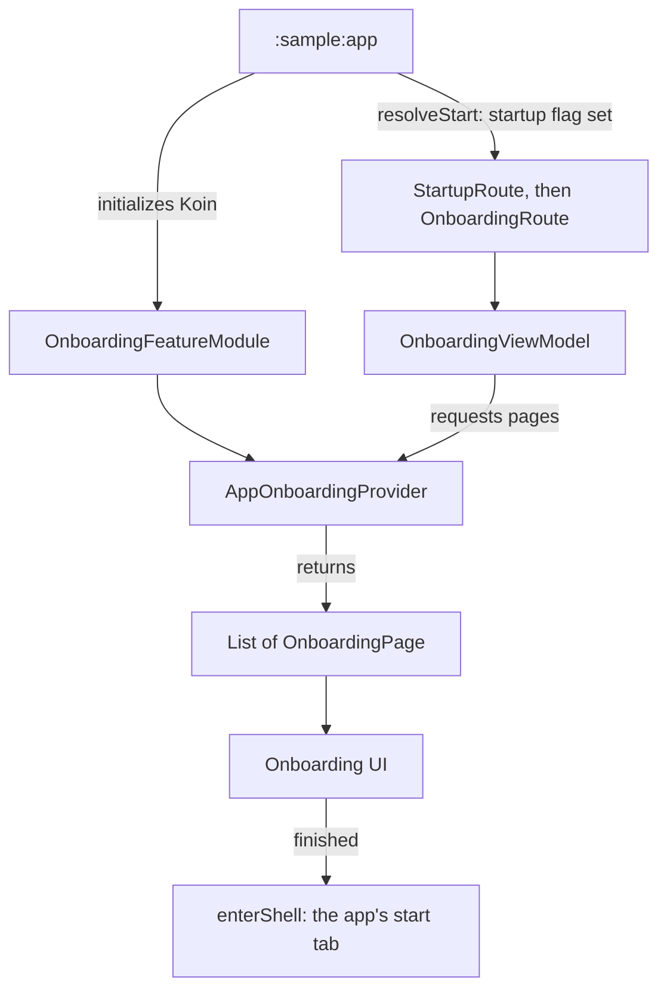

# `:sample:feature:onboarding` Logic Graph

## Purpose

Handles the application's first-launch onboarding experience by providing specific pages and
completion logic to the App Toolkit's onboarding infrastructure.

## Owns

- `AppOnboardingProvider`, which defines five pages: Welcome, Theme, Quick Settings, telemetry
  usage and diagnostics consent, and Finish. The consent page reuses `TelemetryOnboardingPage` from
  the Toolkit and passes its pager selection state so its dialog opens only when selected.
  Consent choices also remain available in Settings under Security and Privacy.
- Stable onboarding page identifiers in `ui/models`.
- Onboarding-specific strings and keys.
- `OnboardingFeatureModule`, which connects the sample's provider to the library's
  `OnboardingViewModel`.

## Depends on

- `:library:core:datastore`.
- [`:library:apptoolkit`](../../../library/apptoolkit/README.md) for the core onboarding UI and
  logic.

## Used by

- `:sample:app` as a feature dependency.

## Flow chart

## Architectural decisions

- The sample module intentionally has no `data` package: persistence and its repository
  implementation are owned by `:library:feature:onboarding`; this module only supplies host page
  configuration and DI composition.
- **Completion stays in the Toolkit**: finishing onboarding enters the shell in the same activity,
  so the provider supplies pages only and knows nothing of `:sample:app`.
- **Toolkit Integration**: This module demonstrates the "Provider Pattern" where the sample app
  supplies implementation details to a generic library feature via Koin injection.

## Migration notes

The five-page sample flow includes the telemetry consent page immediately before Finish.
`AppOnboardingProvider` uses the `3.0.0-pre30` name `TelemetryOnboardingPage`, replacing
`FirebaseOnboardingPage` without an alias. The page keeps the stable `crashlytics_options` key
and passes the pager's `isSelected` value. Consent behavior remains owned by diagnostics.
See the [3.0.0 migration guide](../../../docs/migration/3.0.0.md#telemetry-onboarding-page-300-pre30).
