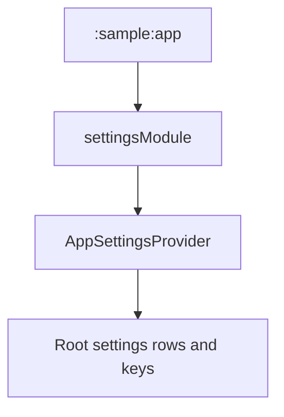

# `:sample:feature:settings` Logic Graph

## Purpose

The sample's root settings rows, supplied to the Toolkit's settings page.

## Owns

- `AppSettingsProvider`, the root settings categories, notification action, and Toolkit page keys.
- `SettingsConstants`, the stable keys of those rows.

## Does not own

- The settings pages themselves, owned by
  [`:library:feature:settings`](../../../library/feature/settings/README.md) and the feature modules
  that register the keys the rows open.
- Startup, display, and About metadata providers, owned by the separate sample features.
- The About page, which `:sample:app` registers as the Toolkit's own `AboutScreen`.
- Toolkit module ordering, owned by [`:sample:core:apptoolkit`](../../core/apptoolkit/README.md).
- The startup-screen choices, composed by `:sample:app`, which is the only module that may name
  every top-level destination.

## Depends on

- [`:library:apptoolkit`](../../../library/apptoolkit/README.md) for the settings contracts.

## Used by

- `:sample:app`, which passes `settingsModule` to `appToolkitHostModules`.

## Flow chart

## Architectural decisions

- Feature providers stay with their owning sample feature. Settings, startup, display, and about
  are separated now so each area can expand without putting feature code back into core.
- This sample adapter has no `domain` or `data` package: it only describes rows.
- The About version-tap unlock, which showed the debug pages in release builds, was removed with
  `AboutSettingsScreen`, `AboutSettingsViewModel`, `ShowcaseUnlockRepository` and the
  `:sample:core:datastore` module that stored its flag. The debug pages are registered only in
  debug builds.

## Public contracts

- `settingsModule`, `AppSettingsProvider`, `SettingsConstants`.
