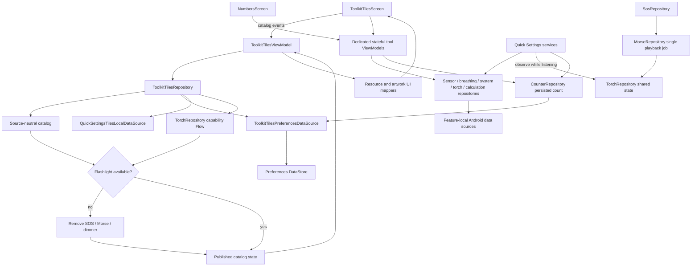

# `:sample:feature:tiles` Logic Graph

## Purpose

Quick tools and numbers workspace: the in-app tool catalogue, the dedicated Numbers calculation screen, and the Quick Settings tile services behind tile-ready tools.

## Owns

- `ToolkitTilesRepository`, which owns the source-neutral catalogue and coordinates current tile
  status with persisted category expansion preferences.
- Local data sources for preferences, Quick Settings, sensors/display, haptics, and
  torch access.
- `SensorRepository`, `BreathingRepository`, `TorchRepository`, `MorseRepository`,
  `SosRepository`, `CounterRepository`, `UnitConversionRepository`, `BillSplitterRepository`, and
  `RulerRepository`, which
  remain the data-layer entry points and own coordination or runtime state.
- UI catalogue models and mappers, `ToolkitTilesScreen`, `NumbersScreen`, the screen and dedicated
  tool ViewModels, tool composables, and the Quick Settings services. `ToolkitTilesRoute` and
  `NumbersRoute` belong to `app/navigation`.
- Localized Quick Tools and Numbers strings and plurals, and the Quick Settings tile and coin icons.
- Feature-owned manifest permissions for haptics and flashlight access. The feature
  declares no foreground service and no wake locks.

## Does not own

- Its registration as tabs, done by `:sample:app`'s `appGraph`.
- Native ad rendering, owned by [`:library:core:ui`](../../../library/core/ui/README.md); this
  module supplies only the quick-tools card styling.

## Depends on

- `:sample:core:analytics` and `:sample:integration:ads`.
- [`:library:apptoolkit`](../../../library/apptoolkit/README.md) for ad slots and screen contracts.

## Used by

- `:sample:app`, for DI and the navigation graph.

## Flow chart

## Architectural decisions

- Repositories are the only entry points to platform-backed sources; ViewModels and framework
  services do not call sensor, torch, haptics, or settings sources directly.
- The catalog is source-neutral. Resource IDs, icons, descriptions, and ad styling are mapped in the
  UI layer after availability filtering.
- `currentTileCategories()` is suspend and safe to call from the main thread. The Quick Settings
  source moves its Settings provider and preference snapshot reads to injected IO; the ViewModel
  switches only its own UI-model mapping to Default.
- Torch state is shared because in-app tools and system-created services can operate concurrently.
  Morse start/stop operations are suspending and serialized. Replacement and shutdown await the
  previous job's final torch-off command before returning; SOS delegates to the same owner.
- Counter writes remain process-owned while callers await completion and receive storage failures.
  Tile services catch and report action failures, and a destroyed caller cannot cancel an accepted write.
- Membership writes pass through `ToolkitTilesRepository`. DI supplies the request-key-to-component
  registry to the local source; data code does not import UI service declarations.
- Each tool with behavior of its own has a dedicated ViewModel, one class per file in `ui/`, with
  its `XToolUiState` in `ui/states/` and its `XToolEvent` in `ui/contracts/`. Every one extends
  `LoggedScreenViewModel` and reports under its owning screen name (`ToolkitTiles` for catalog tools,
  `Numbers` for `BillSplitterToolViewModel`, `UnitConverterToolViewModel`, and `RandomNumberToolViewModel`),
  with the class name as `viewModelName`. One-shot
  work (a flip, a roll, a counter write, a torch change) runs through `launchReport`, and repository
  streams (sensor readings, torch and Morse playback state, the stored count) through `collectReport`
  for the ViewModel's lifetime. The routes in `ToolRoutes.kt` collect `state` and send events: the
  Compass and Level sensors start and stop with the app's foreground state, Screen Light and Ruler
  open as full-screen dialogs (putting the ruler graduations flush against the screen edge), and
  every tool is dismissed when its sheet or dialog leaves composition. No tool ViewModel queues
  messages, so the routes host no `MessageHost`; their failures are only reported.
- Material Colors has no ViewModel; its dialog is local UI behavior.
- The catalogue screen is on `core.ui.screen`. `ToolkitTilesViewModel` exposes `state`, whose
  `categories` is a `Loadable`, and builds the UI models on the default dispatcher, its own CPU work.
  Adding a tile is a state flag, `pendingTileRequest`, that `ToolkitTilesScreen` turns into the
  Quick Settings request and clears with `TileRequestLaunched`. The no-tile message is a queued
  message shown as a toast, because it comes while a tool's bottom sheet would cover a snackbar.
  `ToolkitTilesScreen` and the stateless `ToolkitTilesScreenContent` share `ToolkitTilesScreen.kt`.

## Public contracts

- `ToolkitTilesRepository`, `TorchRepository`, `MorseRepository`, `CounterRepository`,
  `UnitConversionRepository`, `BillSplitterRepository`, `RulerRepository`, `ToolkitTilesViewModel`,
  the dedicated tool ViewModels, `ToolkitTilesScreen`, `NumbersScreen`, and the source-neutral
  tile models.

## Internal implementations

- Camera2 torch discovery/control, sensor sampling, haptics, Quick Settings inspection, UI
  catalogue mapping, and tool composables.

## Source ownership and risks

Android platform APIs are isolated in `data/local` sources. ViewModels and services use
repositories as the data-layer entry points, while source interfaces provide deterministic test
boundaries around external resources.

`ToolkitTilesRepository` removes SOS, Morse and Flash Dimmer from the published catalogue when the
shared torch capability reports that no flashlight is available. Catalogue resource IDs and
artwork identifiers live in UI models and mappers; the repository publishes only source-neutral
IDs, status, behavior kind, and platform request keys.

`TorchRepository` has a contract because Morse/SOS, the in-app dimmer and a system-created Quick
Settings service share one observable source of truth. `MorseRepository` owns the only patterned
torch playback job; SOS delegates its fixed message to it so custom Morse, SOS and steady
brightness controls cannot compete. Torch strength is exposed on Android 13+ when hardware reports
multiple levels; older and single-level devices fall back to a binary toggle.

### Quick Settings tile services

Every service extends `TrackedTileService`. Tiles backed by shared state (Flash Dimmer, Counter)
render from their repository between `onStartListening` and `onStopListening`, so changes made by the
in-app tool, the system flashlight or SOS/Morse appear while the panel is open. Rendering a snapshot
once instead leaves a stale tile, most visibly when the torch was already on before the process
started and the camera reports it only after the first render.

The Counter tile and the in-app Counter share one DataStore-backed count through
`CounterRepository`. System UI unbinds tile services freely, so an in-memory count would silently
reset; closing the Counter sheet no longer clears the count, and its Reset button resets the tile.

Tile subtitles exist only from Android 10, below the module's minimum SDK. `TileText` moves a tap's
result into the label on Android 8 and 9, where it would otherwise be invisible. Declining the
system add-tile prompt is treated as the user's choice, not as a failure.

## Search and filtering

The top filter chips narrow the catalogue by category (`All`, `Sensors`, `Utilities`, `System`,
`Wellbeing`) and automatically expand the selected category. The tab also declares a search field in
its app bar, and `ToolkitTilesScreen` reads its query from `LocalShellSearch`. After the filter
chips, `search` keeps a whole category whose name matches, or only the tiles whose title or summary
match; every match is shown expanded, whatever the stored expansion. Collapse controls are hidden
while a category filter or search forces sections open, preserving the saved expansion in All tools.
Titles and summaries are string
resources, so the query is matched against them in the current language. `ToolkitTilesSearchTest`
covers both category filtering and search rules.

The four category groups use a regular scrolling column. This bounded catalogue keeps category
nodes active while expansion changes their height, avoiding lazy-list deactivation during
lookahead remeasurement. Category and tool entrances, the filters, and saved scroll position remain
in the feature. `ToolkitTilesScreenTest` exercises repeated scrolling and expansion inside a
lookahead scope.

The catalogue places one native ad card between the middle category groups. A single-category
result puts the ad after the tools, and an empty result has no ad. Empty/error state native ads
are also suppressed.

## Migration notes

The catalogue and status pass formerly lived in pass-through use cases. They remain repository
work, while all Android resource and artwork mapping now happens in the UI layer. Stateful or
platform-backed bottom-sheet tools retain dedicated ViewModels; the catalogue ViewModel owns only
catalogue, filter, expansion, ad and add/setup state.

### Quick Settings membership and Android versions

`NotAdded` means an unpinned Quick Settings service on Android 13+, where the system add-tile
request is supported. In-app sensor tools remain available. Older versions omit the add action and
retain the Tile-ready tools instructions for manually editing Quick Settings.
The helper card reuses those localized instructions rather than describing missing tool functionality.

Membership normalizes Android's custom tile component format. When secure settings are unavailable,
system tile lifecycle callbacks and successful pin results supply locally recorded membership.
The open tool sheet refreshes after pin requests.

No tool here runs in the background. Every tool works while its sheet is open, which keeps the
feature free of foreground services, wake locks, and the Play Console declarations they carry.

Navigation keys and the complete graph live in `:sample:app` under `app/navigation`.
Features expose callbacks rather than importing app-owned route keys.

## Service components

Quick Settings entry points live in the feature services package. Their manifest component names
changed from ui.services to services in pre28. Remove and re-add any sample tiles pinned before
that update. Tile IDs and preference keys are unchanged; tile text models live in ui/models.

## Shared presentation

- `DiceRollTool` is the only public dice entry point; its renderer stays private.
- `MessageToastHost` from core UI presents queued tool messages with short errors, preserving the
  sheet behavior without a local copy of the host.
- `ToolkitTilesNativeAdViewFactory` adapts the default Compact holder's padding, icon size and
  headline cap. `NativeAdStyle` owns the round badge, inset and text-action appearance.

## Counter correction

The in-app Counter includes a decrement button for correcting a miscount without resetting.
It updates the count shared with the Quick Settings tile and stops at zero.

## Numbers screen and offline tools

Protractor uses on-screen alignment from 0 to 180 degrees. Tap or drag its movable arm, or use the
accessible slider. It needs no camera permission or sensor, and belongs to Sensors & Measurement.

`NumbersScreen` (`NumbersRoute`) presents a warm gold hero banner ("Count, split & convert"),
two clickable cards under "Calculate & convert" (`Tip & Bill Splitter` and `Unit Converter`),
and a live interactive `Counter` workspace card alongside clickable cards for `Random Number Picker`
and `Dice Roll` under "Count & chance". `Tip & Bill Splitter`, `Unit Converter`, and `Random Number Picker`
have been removed from the `Quick Tools` catalogue (`DefaultToolkitTilesRepository`). The splitter accepts a
non-negative bill with up to two decimal places, tips of 10%, 15% or 20%, and a positive whole number
of people. `BillSplitterRepository` uses decimal arithmetic, rounds the tip once to two decimal
places, then rounds each share up so the collected amount covers the total. The UI explains that
rounding. Tip choices use a segmented control, and people can be typed or adjusted one at a time
without going below one or overflowing the supported count. The tool uses the same unit as the entered bill; it does not convert currencies.

Random Number Picker animates result digits with the Toolkit's `AnimatedDigit`. Grouping separators
and signs stay static, long results can wrap, and accessibility reads the complete localized number.
It draws uniformly from an inclusive signed 64-bit integer range. Equal bounds
return that number. Presets set 1 to 2, 6, 10 or 100 without generating a result; editing either bound
or selecting a preset clears the previous result. Invalid, reversed or overflowing bounds clear the result. The numeric tools reuse the
localized numeric input parser and report use through their dedicated ViewModels. Closing a sheet
resets its inputs and result, matching the other non-persistent tools.
